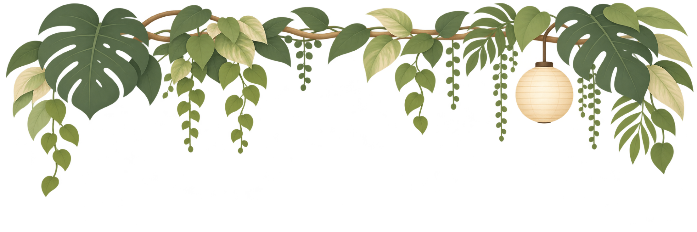
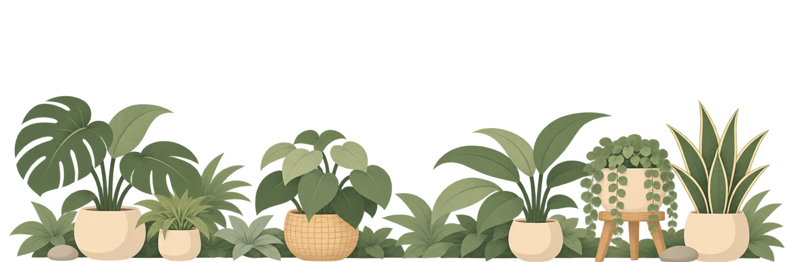

  

<h1 align="center">Dave-Olivier INZA-CRUZ</h1>

  <strong> 42 Paris · Software engineer student </strong> 
  🌿 

## 🌱 About me

- 📍 Based in **Paris, France**
- 💻 Building things with **C and C++**
- 🌿 Interested in low-level programming and understanding how things work under the hood
- 🔍 Currently working on **reverse engineering**

## 🛠️ My toolbox

| Domain | Tools & Technologies |
| :--- | :--- |
| **Languages** | C · C++ |
| **Development** | Git · VS Code |
| **Creative** | Blender · Photoshop |

## 📬 Reach me

Have a project in mind, an idea to share, or just want to say hi?

Feel free to reach out!

  

